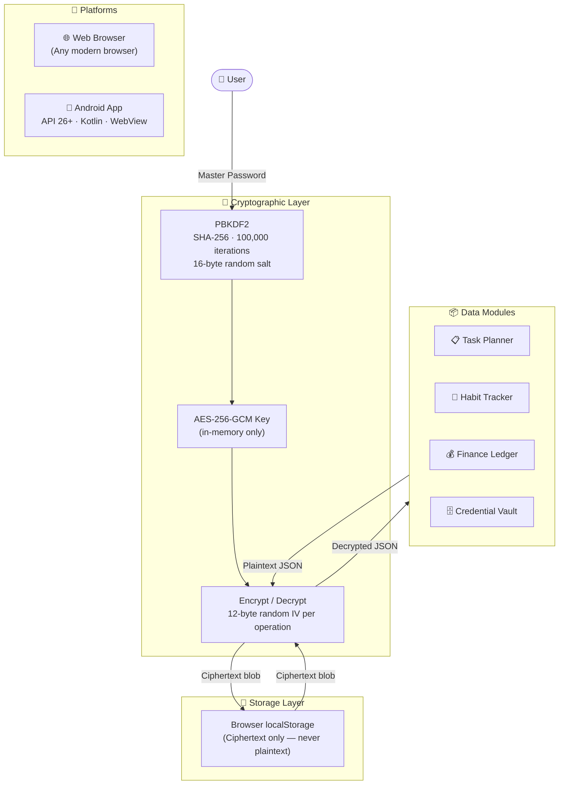

<div align="center">


<br /><br />

```
███████╗███████╗ ██████╗██╗   ██╗██████╗  ██████╗ ███████╗██████╗  █████╗  ██████╗███████╗
██╔════╝██╔════╝██╔════╝██║   ██║██╔══██╗██╔═══██╗██╔════╝██╔══██╗██╔══██╗██╔════╝██╔════╝
███████╗█████╗  ██║     ██║   ██║██████╔╝██║   ██║███████╗██████╔╝███████║██║     █████╗  
╚════██║██╔══╝  ██║     ██║   ██║██╔══██╗██║   ██║╚════██║██╔═══╝ ██╔══██║██║     ██╔══╝  
███████║███████╗╚██████╗╚██████╔╝██║  ██║╚██████╔╝███████║██║     ██║  ██║╚██████╗███████╗
╚══════╝╚══════╝ ╚═════╝ ╚═════╝ ╚═╝  ╚═╝ ╚═════╝ ╚══════╝╚═╝     ╚═╝  ╚═╝ ╚═════╝╚══════╝
```

### *Zero-Knowledge Daily Dashboard & Cryptographic Vault*

**Your personal life — tasks, finances, credentials — protected by military-grade encryption.  
No server. No cloud. No compromise.**

[🌐 **Live Demo**](https://Affan19261.github.io/securospace) &nbsp;|&nbsp;
[📱 **Download APK**](https://github.com/Affan19261/securospace/releases/latest) &nbsp;|&nbsp;
[🐛 **Report Bug**](https://github.com/Affan19261/securospace/issues/new?template=bug_report.md) &nbsp;|&nbsp;
[💡 **Request Feature**](https://github.com/Affan19261/securospace/issues/new?template=feature_request.md)

</div>

---

## 🔐 What is SecuroSpace?

SecuroSpace is a **privacy-first personal productivity vault** built on a simple but radical premise:

> *Your data belongs to you. It lives on your device, encrypted with your password. No one else — not even the developers — can ever read it.*

Every byte you save (tasks, budgets, passwords, notes) is encrypted with **AES-256-GCM** before it ever touches storage. The encryption key is derived from your master password using **PBKDF2 with 100,000 SHA-256 iterations** and a unique salt — a key derivation function so slow that brute-force attacks are computationally infeasible.

---

## ✨ Features

| Feature | Description | Encrypted |
|---------|-------------|-----------|
| **Daily Task Planner** | Add, complete, and delete daily tasks with real-time stats | ✅ AES-256 |
| **Habit Tracker** | Track daily habits with streak counting | ✅ AES-256 |
| **Finance Manager** | Log income/expenses with a live chart visualization | ✅ AES-256 |
| **Secure Credential Vault** | Store login credentials with username/password | ✅ AES-256 |
| **Secret Note Vault** | Store sensitive text, recovery codes, private notes | ✅ AES-256 |
| **Password Strength Analyzer** | Real-time entropy analysis with detailed feedback | — |
| **Cryptographic Console** | Live log of all crypto operations with timestamps | — |
| **Vault Health Index** | Security score gauge with diagnostics | — |
| **Auto-Lock (5 min)** | Automatic session lock after inactivity | — |
| **Encrypted Export/Import** | Portable backup that stays encrypted | ✅ AES-256 |
| **Emergency Wipe** | Instant factory reset — destroy all local data | — |
| **Biometric Unlock** | Android: fingerprint/face unlock layer (optional) | — |

---

## 🏗️ Architecture



---

## 🛡️ Security Model

```
┌─────────────────────────────────────────────────────────────────┐
│                    SECUROSPACE THREAT MODEL                      │
├─────────────────────────────────────────────────────────────────┤
│ ✅ PROTECTED AGAINST                                             │
│   • Server breaches (no server exists)                           │
│   • Network interception (no network requests)                   │
│   • localStorage snooping (all data is AES-256 ciphertext)       │
│   • Weak passwords (entropy-analyzed, PBKDF2 strengthened)       │
│   • Brute force (100k PBKDF2 iterations = ~0.3 hashes/sec)      │
│                                                                   │
│ ⚠️  NOT PROTECTED AGAINST                                        │
│   • Physical access to unlocked device                           │
│   • Compromised OS / keylogger                                    │
│   • Loss of master password (no recovery by design)              │
└─────────────────────────────────────────────────────────────────┘
```

| Component | Algorithm | Parameters |
|-----------|-----------|------------|
| Key Derivation | PBKDF2 | SHA-256 · 100,000 iterations · 16-byte salt |
| Encryption | AES-GCM | 256-bit key · 12-byte random IV |
| Entropy Analysis | Shannon entropy | Character pool-based bit calculation |
| Runtime | Web Crypto API | Native OS primitives — no JS crypto libs |

---

## 🚀 Getting Started

### 🌐 Web (Instant — No Install)

```bash
# Clone the repo
git clone https://github.com/Affan19261/securospace.git
cd securospace

# Serve with any HTTP server
python -m http.server 8000
# → Open http://localhost:8000
```

Or simply open the [**Live Demo**](https://Affan19261.github.io/securospace) — no install needed.

---

### 📱 Android App

#### Option A — Build from Source (Recommended)

**Prerequisites**: Android Studio Hedgehog+, JDK 17, Android SDK 26+

```bash
# 1. Clone the repository
git clone https://github.com/Affan19261/securospace.git
cd securospace

# 2. Sync web assets into Android project
# Windows:
android\sync-assets.bat
# Linux/Mac:
cp index.html style.css app.js crypto-helper.js android/app/src/main/assets/

# 3. Open android/ in Android Studio, or build via CLI:
cd android
./gradlew assembleDebug

# 4. Install on connected device
adb install app/build/outputs/apk/debug/app-debug.apk
```

#### Option B — Download Pre-Built APK

Download the latest release APK from the [**Releases page**](https://github.com/Affan19261/securospace/releases/latest).

> **Note**: You may need to enable *Install from unknown sources* in Android settings.

---

## 📁 Project Structure

```
securospace/
├── 🌐 Web App
│   ├── index.html          # Main HTML structure & UI
│   ├── style.css           # Dark cyberpunk design system
│   ├── app.js              # Application controller & state
│   └── crypto-helper.js    # Web Crypto API wrapper (PBKDF2, AES-GCM)
│
├── 📱 Android App
│   └── android/
│       ├── app/src/main/
│       │   ├── java/com/securospace/app/
│       │   │   ├── MainActivity.kt      # WebView host + biometric
│       │   │   └── SplashActivity.kt    # Branded splash screen
│       │   ├── assets/                  # Bundled web app (auto-synced)
│       │   ├── res/                     # Icons, layouts, themes
│       │   └── AndroidManifest.xml
│       ├── sync-assets.bat              # Asset sync helper (Windows)
│       └── build.gradle
│
└── 📋 GitHub
    ├── .github/
    │   ├── workflows/ci.yml             # CI: validate + build APK + deploy pages
    │   ├── ISSUE_TEMPLATE/              # Bug & feature templates
    │   └── PULL_REQUEST_TEMPLATE.md
    ├── SECURITY.md                      # Responsible disclosure policy
    ├── CONTRIBUTING.md                  # Contributor guide
    └── LICENSE                          # MIT
```

---

## 🔮 Roadmap

- [x] AES-256-GCM encrypted storage
- [x] PBKDF2 key derivation
- [x] Task planner + Habit tracker
- [x] Finance ledger + chart
- [x] Credential & secret note vault
- [x] Export / Import encrypted backup
- [x] Security diagnostics dashboard
- [x] Auto-lock session timer
- [x] Android app (WebView + Biometric)
- [ ] Password generator with policy settings
- [ ] TOTP / 2FA code generator in vault
- [ ] Encrypted file attachments
- [ ] Multiple vault profiles
- [ ] Dark/Light theme toggle
- [ ] iOS PWA support

---

## 🤝 Contributing

Contributions are warmly welcome! Please read [CONTRIBUTING.md](CONTRIBUTING.md) first.

1. Fork the repo
2. Create a feature branch (`git checkout -b feat/amazing-feature`)
3. Commit with convention (`git commit -m 'feat: add amazing feature'`)
4. Push and open a Pull Request

---

## 🔏 Security

Found a vulnerability? **Please don't open a public issue.** Read our [Security Policy](SECURITY.md) and use GitHub's private security advisory feature.

---

## 📄 License

Distributed under the **MIT License**. See [LICENSE](LICENSE) for details.

---

<div align="center">

Built with 🔐 and zero trust.

**[⭐ Star this repo](https://github.com/Affan19261/securospace)** if SecuroSpace helped you take control of your privacy.

</div>
